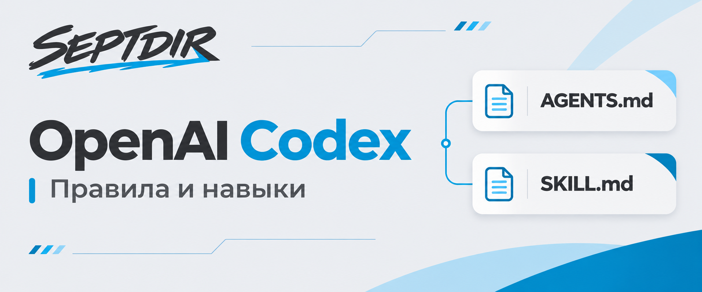

# OpenAI Codex

Личный набор шаблонов `AGENTS.md` и навыков для работы с OpenAI Codex.
Правила собраны из практики разработки: согласовать объём работ, использовать настройки проекта,
писать понятный код и проверять результат по существу.

Шаблоны рассчитаны на работу с JetBrains IDE через MCP: PhpStorm, WebStorm, Rider и PyCharm.
Форматирование и инспекции выполняются средствами IDE; пути библиотек, интерпретаторы и конфигурации запуска
берутся из настроек проекта.

## Что внутри

| Файл | Назначение |
|---|---|
| [AGENTS.coding.md](AGENTS.coding.md) | Шаблон для одного проекта. |
| [AGENTS.coding.multi.md](AGENTS.coding.multi.md) | Общая рабочая область с несколькими Git-репозиториями и проектами IDE. |
| [Skills/code-rules](Skills/code-rules) | Общие правила кода и правила JS/TS, PHP, C# и Python. |

Выбранный шаблон устанавливается в проект под именем `AGENTS.md`.

### Навыки

| Навык | Назначение |
|---|---|
| [septdir-codex-maintain](Skills/septdir-codex-maintain/SKILL.md) | Установка и обновление шаблонов и навыков, сопровождение правил, исправление `cwd` после переноса проекта. |
| [septdir-code](Skills/septdir-code/SKILL.md) | Проектирование и изменение кода, форматирование и инспекции затронутых файлов. |
| [septdir-inspect](Skills/septdir-inspect/SKILL.md) | Диагностика указанного списка файлов через MCP IDE. |
| [septdir-vibe-review](Skills/septdir-vibe-review/SKILL.md) | Пересмотр большого этапа разработки агентом: нужен ли код, обоснованы ли решения и на своём ли месте реализация. |
| [septdir-commit](Skills/septdir-commit/SKILL.md) | Подготовка и создание согласованного Git-коммита. |

## Установка

1. Скачай библиотеку в постоянный каталог на компьютере.
2. Скопируй папку `Skills/septdir-codex-maintain` в каталог пользовательских навыков Codex.
   В Windows это `%USERPROFILE%\.codex\skills\septdir-codex-maintain`.
3. В установленном `SKILL.md` замени `<путь>` в строке «Каталог исходников шаблонов и навыков»
   на абсолютный путь к этой библиотеке.
4. Открой свой проект в Codex и вызови навык:

   ```text
   $septdir-codex-maintain
   Подготовь AGENTS.md и общие навыки для этого проекта.
   Используй AGENTS.coding.md. Сначала покажи черновик и предлагаемые изменения.
   ```

Для общей рабочей области с несколькими репозиториями укажи `AGENTS.coding.multi.md`.

Навык подготовит черновик, предложит проектные дополнения отдельно и дождётся согласования.
В проект копируются выбранные навыки, `common.md` и правила только используемых языков.
Ссылки приводятся к установленному набору. В «Доступах» остаются предоставленные данные;
пустые пункты шаблона удаляются.

## Работа с проектом

Перед правками агент показывает **gate**: ожидаемый результат, полный объём работ, выбранные навыки
и границу проверок. После согласования отправь нужный token отдельной строкой:

| Token | Действие |
|---|---|
| `edit_agent` | Агент вносит согласованные изменения. |
| `edit_user` | Агент выдаёт код в чате, изменения вносишь самостоятельно. |
| `create_commit` | Создать коммит после отдельной подготовки и согласования. |

Подробные правила разрешений, проверок и работы с инструментами находятся в проектном `AGENTS.md`.

## Обновление

Обнови исходники библиотеки в указанном каталоге и попроси в чате проекта:

```text
$septdir-codex-maintain
Обнови AGENTS.md и общие навыки из библиотеки.
Сохрани проектные настройки, доступы, собственные навыки и доработки.
Сначала покажи точные изменения.
```

В проектах используются локальные копии. Изменения библиотеки применяются через навык после согласования.
Уведомление остальных неархивных чатов проекта запрашивается отдельно.

## Отказ от ответственности

Материалы предоставляются «как есть», без гарантий корректной или безопасной работы ИИ-агента.
Пользователь самостоятельно проверяет его действия и результаты.
В пределах, допускаемых законом, автор не несёт ответственности за ущерб, потерю данных и другие последствия использования материалов.
